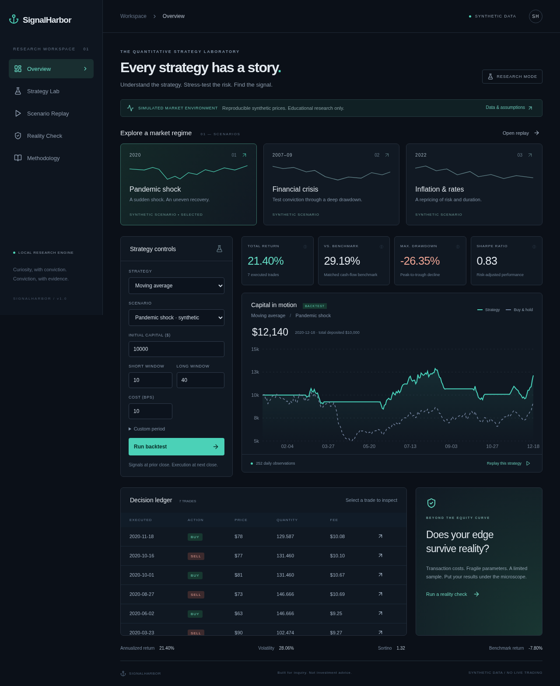

# SignalHarbor

**Understand the strategy. Stress-test the risk.**

A self-contained quantitative research laboratory: configure a strategy, replay its decisions, and challenge the result with cost and parameter sensitivity experiments. No account, API key, brokerage connection, or paid service is required.



## Run locally

Requires Node 22+ and Python 3.12. From this repository:

```sh
npm ci
python -m venv .venv
.venv/bin/pip install -r requirements-lock.txt
```

For the complete application with one server, run:

```sh
./run.sh
```

Open `http://localhost:8000` on your own machine. The launcher builds the interface and serves it together with the API. Set `PORT` to change the port.

For frontend hot reload, use two terminals from the repository root:

```sh
.venv/bin/uvicorn backend.main:app --host 0.0.0.0 --port 8000
```

```sh
npm run dev -- --port 5173
```

Open the local Vite address shown by the terminal. Vite forwards `/api` to FastAPI. Interactive API documentation is served by FastAPI at `/docs`.

## Features

- Five calculated long-only strategies: buy-and-hold, moving-average exposure, RSI reversal, momentum, and dollar-cost averaging.
- Configurable capital, fees, indicator windows, contribution amount, and dates within scenario coverage.
- Three reproducible **synthetic** market regimes inspired by crisis, pandemic, and inflation periods. These are not authentic historical prices.
- Strategy versus cash-flow-matched buy-and-hold equity curves.
- Play, pause, reset, and scrub replay; equity, drawdown, and trades follow the cursor. Summary metrics describe the complete run.
- Decision ledger with recorded rule, indicator values, fees, prior signal date, quantity and exposure.
- Reality Check reruns five fee assumptions and nine moving-average parameter combinations, with sample-length and frequency diagnostics.
- Responsive dark interface, metric explanations, validation errors and methodology.

## Architecture

React + TypeScript + Vite → HTTP JSON → FastAPI/Pydantic → NumPy simulation engine. Recharts renders the returned observations. Lucide provides icons. Vite was chosen instead of Next.js because this app needs neither server-side rendering nor a second application server beyond FastAPI. Pandas is unnecessary for the small, explicitly ordered dataset.

- `backend/engine.py`: seeded datasets, typed inputs, indicators, accounting, metrics and sensitivity reruns.
- `backend/main.py`: health, scenario and backtest endpoints.
- `src/main.tsx`: research interface and replay state.
- `tests/`: numerical and API regression tests.
- `e2e/`: actual browser workflow, responsive check and screenshots.

## Verify

```sh
.venv/bin/python -m pytest -q
npm test
npm run build
# With both local servers running and Chromium installed:
npx playwright test
```

Playwright uses `/usr/bin/chromium`; set `CHROMIUM_PATH` to another installed executable. End-to-end tests capture `docs/overview.png` and `docs/mobile.png`. No mock backtest API is used.

## Financial methodology

The engine uses the prior session's closing observations to decide exposure and executes at the current close. SMA compares trailing short and long simple means; momentum is positive trailing price return; RSI uses a 14-session simple gain/loss mean, buys below the lower threshold and exits above the upper threshold. Initial allocations execute at the first close. Indicator warm-up stays in cash. The SMA rule uses relative levels; crossings cause state changes, with initial entry once the first valid signal is available.

Cash earns zero. Shares are fractional. Fees are basis points of traded notional on both buys and sells; buying reserves the fee. DCA deposits before the day's execution every 21 sessions and invests the initial capital immediately. Benchmark deposits and fee rates match the strategy. Portfolio dollars include deposits; time-weighted returns remove those deposits. DCA and other strategies therefore have different capital requirements.

Daily returns are `(ending_equity - contribution) / prior_equity - 1`, including first-session costs relative to initial cash. Total return compounds those returns. Annualization uses 252 sessions; volatility uses sample standard deviation. Sharpe uses annualized arithmetic daily mean divided by annualized volatility at zero risk-free rate. Sortino uses annualized daily mean divided by annualized root mean squared negative daily returns (positive days count as zero). Undefined ratios show a dash. Maximum drawdown uses cumulative time-weighted wealth. Benchmark-relative performance is the difference in total time-weighted returns. Win rate is not reported: closed-lot matching is not implemented.

## Data, licensing and limitations

All prices are generated locally with fixed NumPy seeds and stylized return shocks. There is no third-party market dataset or market-data licensing claim. Dates are weekdays, not exchange sessions; holiday closures, dividends, taxes, slippage, intraday execution, capacity and market impact are omitted. Prices are single synthetic assets, not real tickers. No external CSV importer, irregular-date annualization or missing-data imputation is offered. Input validation rejects unsupported parameters and periods with insufficient observations.

Sensitivity is in-sample, not proof against overfitting. There is no out-of-sample optimization or guarantee of future results. Name availability and similar public products were not independently researched because web research tools were unavailable. Do that before public release.

## Deployment recommendation

Build with `npm ci && npm run build`; serve `dist/` behind an HTTPS reverse proxy with SPA fallback and route `/api` to a private Uvicorn process. Keep ports private, add request limits and operational monitoring before a public launch. Vite is a development server. The repository can be published independently of deployment. Publishing code does not create a hosted application.

Suggested repository description: **An interactive quantitative strategy laboratory with causal backtests, scenario replay and explainable risk diagnostics.**

Suggested topics: `quantitative-finance`, `backtesting`, `fastapi`, `react`, `typescript`, `data-visualization`, `portfolio-project`.

Future improvements: licensed historical data and exchange calendars, out-of-sample evaluation, slippage models, multi-asset portfolios, closed-lot win rate, richer accessibility auditing and import validation.
